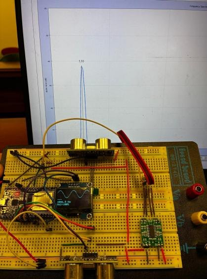
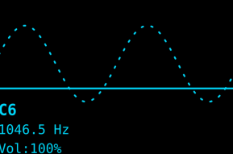
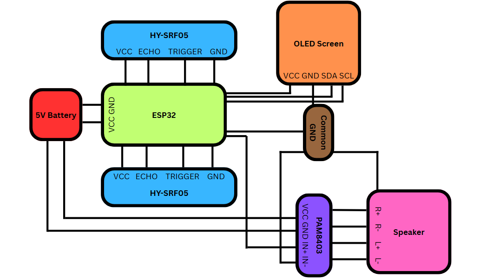
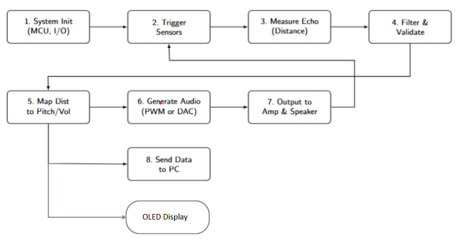
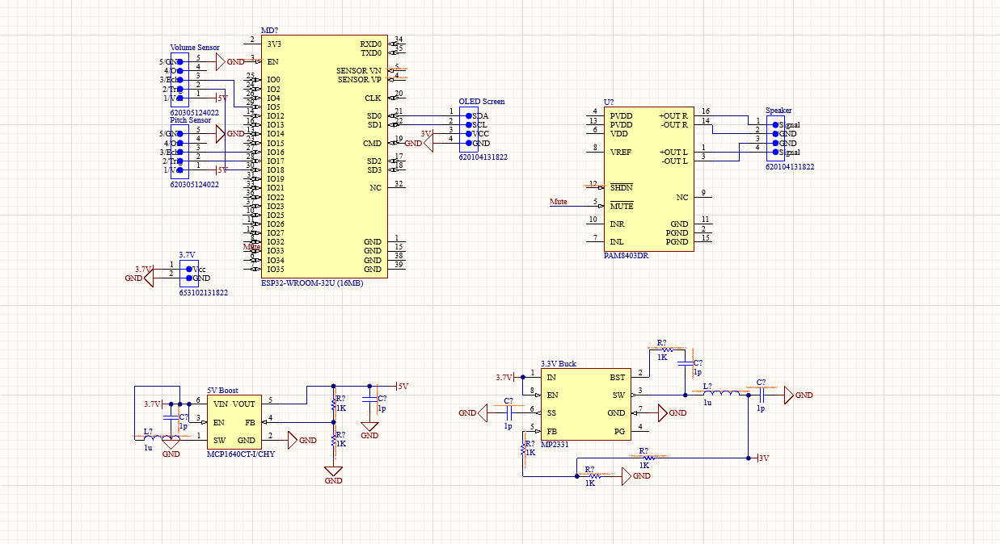
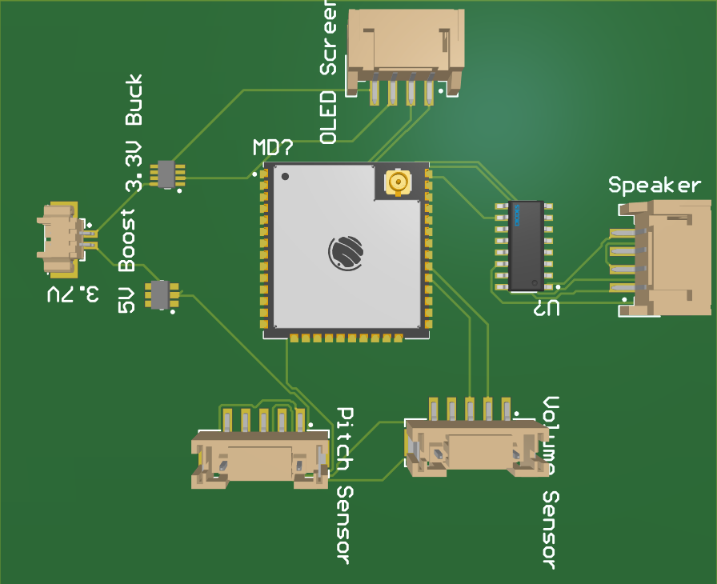
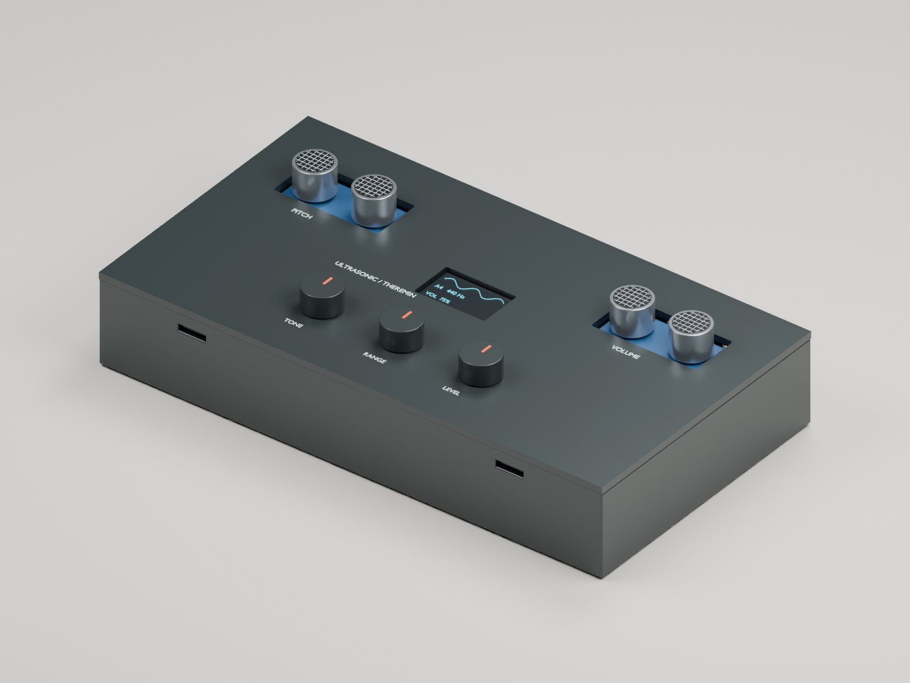
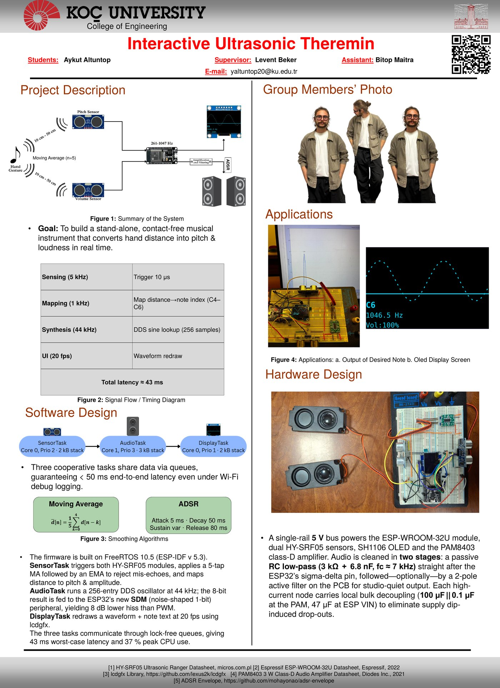

# Interactive Ultrasonic Theremin

Senior design project (ELEC 491, Koç University, advisor Dr. Levent Beker). A musical instrument played by moving your hands in the air, with ultrasonic distance sensing instead of the capacitive sensing of a classic theremin. An invention disclosure was filed for it.



A classic theremin is sensitive to humidity, nearby objects and electrical noise, and hard to calibrate. This one keeps the same gestures: one ultrasonic sensor measures how far one hand is and sets the pitch over two octaves (C4 to C6), the other sets the volume, and a small OLED shows the note, its frequency and the volume while you play.



An ESP32 runs FreeRTOS with three tasks: one reads the sensors, one generates audio and one draws the display. Moving-average and exponential filters smooth the distance readings so the pitch glides instead of jumping. A direct digital synthesis oscillator reads a sine table to make the tone, which goes out through the ESP32's built-in DAC to an amplifier and speaker. The final report describes a variant with an ADSR envelope and sigma-delta output.





| Schematic | PCB (3D view) |
|---|---|
|  |  |

After the course I modeled a 3D-printable enclosure for it in Blender: a two-piece case that snaps together without screws, with windows for the two ultrasonic modules (pitch on the left, volume on the right), the OLED, and three knobs for tone, range and level. The knobs are a proposal for the next version; the current firmware does not read them yet. The case has not been printed or fit-tested yet.





## Files

```
firmware/main/ultrasonic_theremin.c   ESP-IDF application: FreeRTOS tasks, DDS, filters
docs/                                 final report, poster, proposal, images
mechanical/                           Blender enclosure model and printable STL shells
```

## Build

The firmware targets ESP-IDF on an ESP32-WROOM-32U. It also needs an HY-SRF05 ultrasonic sensor driver (`ultrasonic.h`) and an SH1106 OLED wrapper based on the lcdgfx library; add those two components to the ESP-IDF project before building.

---

Yaşar Aykut Altuntop · Koç University · [LinkedIn](https://linkedin.com/in/aykutaltuntop) · [GitHub](https://github.com/Aykut0)
